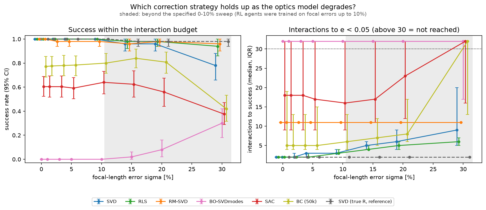
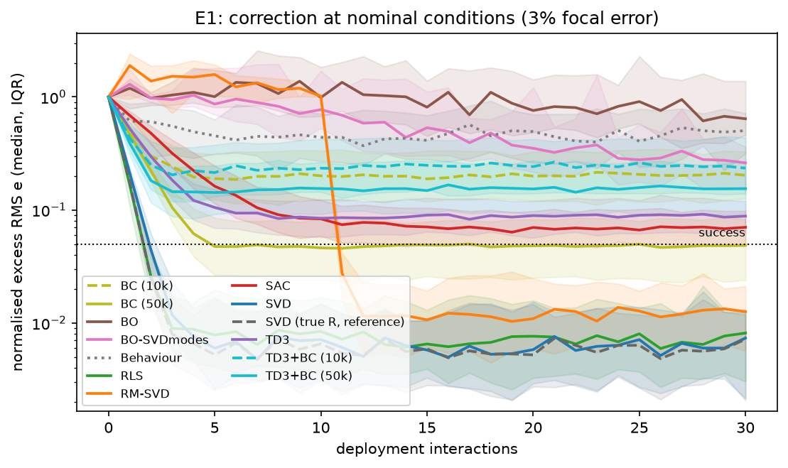
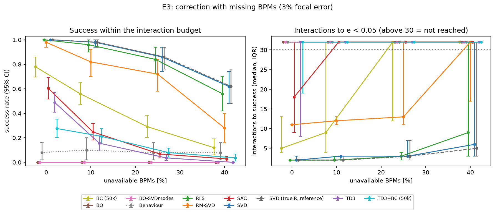
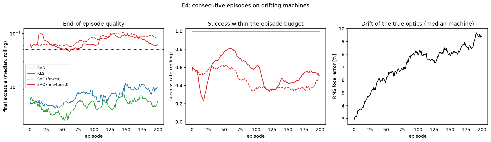
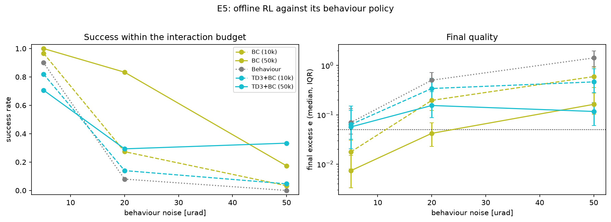

# steerbench

**Sample-efficient trajectory correction on a simulated particle-accelerator transfer line**: a benchmark of classical orbit correction, Bayesian optimisation, online RL and offline RL, measured in the currency that matters on a real machine, which is *deployment interactions*.



<!-- BEGIN:summary -->
With only the design optics model, iterative SVD correction reached the target (normalised excess RMS below 0.05) on 100% of held-out machines in a median of 2 interactions at nominal conditions, matching a privileged true-model reference, and it succeeded on every machine at every level of the specified 0-10% focal-error sweep; it only lost ground beyond that range (at 30%: 78% success, median 9 interactions), where adaptive RLS (94%) and response measurement (96%, but always 11 interactions) held up. Online RL trained with domain randomisation (100,000 simulated steps per agent plus 600,000 for tuning) reached the target on only 60% (SAC) and 49% (TD3) of machines, Bayesian optimisation on 0% within 30 interactions, and offline learning from a noisy SVD log beat its behaviour policy (8%) mainly by imitation: behaviour cloning reached 78% with 50k transitions but 24% with 10k, and TD3+BC 28%. Missing BPMs hurt every method most: with 40% unavailable, SVD succeeded on 62% of machines and no learned method on more than 12%; under 200 episodes of drift, RLS kept a median of 2 interactions while static SVD slowed from 3 to 4.
<!-- END:summary -->

*Every number on this page is generated from `results/` by `scripts/make_readme_table.py`; none is typed by hand. The script also checks that the results still support each qualitative statement and fails otherwise.*

## Reproduce

```bash
pip install -e ".[dev]"
python scripts/run_benchmark.py --config configs/full.yaml
```

This runs everything (tuning, training, E0 to E5), writes `results/` and `figures/`, and keeps the run on a laptop CPU. `configs/quick.yaml` is a smoke test of the whole pipeline with deliberately under-trained agents; it writes to `results/quick/`. To refresh this page afterwards run `python scripts/make_readme_table.py`; to explore the results run the notebook [`notebooks/steerbench_walkthrough.ipynb`](notebooks/steerbench_walkthrough.ipynb), which reads cached results and retrains nothing. If your default Jupyter kernel is a different Python, register the environment first with `python -m ipykernel install --sys-prefix --name steerbench` and choose that kernel.

<!-- BEGIN:runtime -->
Full run: 57 min on a laptop CPU (E0 0.0, TUNE 0.9, TUNE_RL 15.7, TUNE_OFFLINE 3.4, TRAIN 12.5, TRAIN_OFFLINE 5.2, E1 0.4, E2 1.9, E2X 1.2, E3 1.5, E4 8.3, E5 6.0 min).
<!-- END:runtime -->

## Question

When the operator's optics model is imperfect, some beam-position monitors (BPMs) are unavailable, and the machine drifts, which correction strategy reaches target trajectory quality in the fewest interactions with the machine? Every interaction costs beam time, so the central metric is the number of deployment interactions on the target machine, reported separately from any simulation training cost.

Quality is the **normalised excess RMS** `e = (RMS_true - r*) / (RMS_true,initial - r*)`, where `r*` is the residual of an oracle that knows the true optics (a simulator privilege used only for scoring). It starts at 1, and an episode succeeds once `e < 0.05`. Agents see only noisy, masked BPM readings.

### Verdicts on the hypotheses

<!-- BEGIN:hypotheses -->
- **H1 (SVD with an exact model is near-optimal): supported.** With only the design model, SVD matched the privileged true-model reference at nominal conditions.
- **H2 (SVD degrades as model error grows): supported only beyond the specified range.** Iterative SVD with feedback gain kept succeeding throughout the 0-10% sweep, needing slightly more interactions as the error grew; it lost reliability only at 20-30% focal error.
- **H3 (adaptive response estimation recovers the loss): partly supported.** Within 0-10% there was no loss to recover. At 30% RLS and response measurement held up where SVD degraded, and under drift RLS kept needing fewer interactions than static SVD; response measurement always paid its fixed measurement cost.
- **H4 (simulation-trained RL is competitive in deployment interactions): not supported.** SAC and TD3 were less reliable than SVD at every model-error and missing-BPM level tested, on top of a large simulation-training cost; online fine-tuning on deployment data improved SAC under drift but left it far below SVD.
- **H5 (offline RL improves on its behaviour policy only with adequate data): supported, with a caveat.** Every offline agent beat the noisy logging policy, the larger dataset helped markedly, but plain behaviour cloning beat TD3+BC: the gain came from imitating (and denoising) the behaviour policy, not from RL.
<!-- END:hypotheses -->

## Results

### Nominal conditions (E1)

<!-- BEGIN:table-main -->
| Method | Success rate [95% CI] | Interactions to success, median [IQR] | Final excess e, median | Simulation training cost |
|---|---|---|---|---|
| SVD | 100% [100%, 100%] | 2 [2, 3] | 0.007 | none |
| RLS | 100% [100%, 100%] | 2 [2, 2] | 0.008 | none |
| RM-SVD | 98% [94%, 100%] | 11 [11, 11] | 0.013 | none |
| BO | 0% [0%, 0%] | >30 [>30, >30] | 0.641 | none |
| BO-SVDmodes | 0% [0%, 0%] | >30 [>30, >30] | 0.261 | none |
| SAC | 60% [51%, 69%] | 18 [9, >30] | 0.070 | 100,000 env steps (+600,000 tuning) |
| TD3 | 49% [40%, 57%] | >30 [8, >30] | 0.088 | 100,000 env steps (+600,000 tuning) |
| Behaviour | 8% [2%, 16%] | >30 [>30, >30] | 0.503 | none |
| BC (10k) | 24% [17%, 33%] | >30 [>30, >30] | 0.202 | 10,000 logged transitions, 20,000 gradient steps |
| BC (50k) | 78% [69%, 85%] | 5 [4, 13] | 0.049 | 50,000 logged transitions, 20,000 gradient steps |
| TD3+BC (10k) | 16% [11%, 22%] | >30 [>30, >30] | 0.234 | 10,000 logged transitions, 20,000 gradient steps |
| TD3+BC (50k) | 28% [20%, 35%] | >30 [19, >30] | 0.155 | 50,000 logged transitions, 20,000 gradient steps |
| SVD (true R, reference) | 100% [100%, 100%] | 2 [2, 2] | 0.007 | none |
<!-- END:table-main -->



### Robustness (E2, E2X, E3, E4): success rate

`*` marks levels beyond the specified 0-10% sweep; the RL agents were trained on focal errors of at most 10%. The drift column is the last quarter of the E4 episodes (frozen RL agents unless marked).

<!-- BEGIN:table-robustness -->
| Method | focal 0% | focal 10% | focal 20%* | focal 30%* | BPMs off 25% | BPMs off 40% | drift, last quarter |
|---|---|---|---|---|---|---|---|
| SVD | 100% | 100% | 96% | 78% | 86% | 62% | 100% |
| RLS | 100% | 100% | 98% | 94% | 84% | 56% | 100% |
| RM-SVD | 100% | 98% | 98% | 96% | 72% | 28% | - |
| BO-SVDmodes | 0% | 0% | 8% | 30% | 0% | 0% | - |
| SAC | 60% | 64% | 56% | 38% | 7% | 3% | 39% |
| BC (50k) | 77% | 80% | 81% | 42% | 29% | 12% | - |
| SVD (true R, reference) | 100% | 100% | 98% | 98% | 86% | 62% | - |
| TD3 | 44% | 51% | 40% | 20% | 4% | 0% | - |
| TD3+BC (50k) | 26% | 32% | 34% | 18% | 8% | 4% | - |
| Behaviour | 8% | 8% | 12% | 32% | 8% | 8% | - |
| SAC (fine-tuned online) | - | - | - | - | - | - | 50% |
<!-- END:table-robustness -->

| Missing BPMs (E3) | Drift (E4) |
|---|---|
|  |  |

All methods across the full model-error range, including TD3 and TD3+BC: [figures/e2x_model_error_extended.png](figures/e2x_model_error_extended.png).

### Offline RL against its behaviour policy (E5): success rate

<!-- BEGIN:table-offline -->
| Method | Dataset | noise 5 urad | noise 20 urad | noise 50 urad |
|---|---|---|---|---|
| BC | 10k | 97% | 27% | 3% |
| Behaviour | (logging policy) | 90% | 8% | 0% |
| TD3+BC | 10k | 82% | 14% | 5% |
| BC | 50k | 100% | 83% | 17% |
| TD3+BC | 50k | 71% | 29% | 33% |
<!-- END:table-offline -->



### Sanity checks (E0)

<!-- BEGIN:e0 -->
- The unconstrained oracle correction lies within the corrector limit for 97% at 0%, 97% at 1%, 97% at 3%, 96% at 5%, 96% at 10% focal error (1000 sampled machines per level).
- SVD with the exact model, no noise and gain 1 reaches the oracle residual in one interaction on 49 of 50 test machines (largest gap 6.6e-17 mm); on the remaining machine(s) the oracle needs kicks beyond the limit.
<!-- END:e0 -->

## Setup

<!-- BEGIN:setup -->
- **Line:** thin-lens FODO, 10 cells, 5 m between quadrupoles, 90 deg phase advance per cell; 20 BPMs (one per quadrupole), 10 correctors (one per focusing quadrupole).
- **Errors per machine:** focal-length errors (nominal sigma 3%), BPM gains (1%), corrector gains (1%), quadrupole offsets (100 um), injection offset/angle (500 um / 50 urad); BPM noise 50 um.
- **Limits:** |theta| <= 200 urad, |dtheta| <= 200 urad per interaction.
- **Protocol:** 50 held-out test machines, 20 separate validation machines for tuning, 30 interactions per episode, success when the normalised excess RMS drops below 0.05; 5 training seeds per learned method; 6 tuning trials per method; 1000 bootstrap resamples over machines for 95% CIs.
- **Sweeps:** focal error 0%, 1%, 3%, 5%, 10% (E2) and 15%, 20%, 30% (E2X extension); unavailable BPMs 0%, 10%, 25%, 40% (E3); 200 drifting episodes on 5 machines (E4); offline datasets 10k, 50k x behaviour noise 5 urad, 20 urad, 50 urad (E5).
- **Online RL:** SAC and TD3 (stable-baselines3), 100,000 steps per agent on machines with focal-error level drawn from 0-10% and 0-40% of BPMs unavailable.
<!-- END:setup -->

**Physics.** Horizontal plane only. Twiss functions are propagated through 2x2 drift and thin-lens matrices from the matched solution; the response matrix is `R[i, j] = sqrt(beta_i beta_j) sin(mu_i - mu_j)` for BPM `i` downstream of corrector `j` (checked against direct tracking in the tests). Controllers that use a model get the design matrix; the simulator uses the erroneous machine's own optics, BPM gains and corrector calibrations. The initial trajectory comes from injection errors plus quadrupole-misalignment kicks.

**Methods.** All share one interface (`reset`, `act`, `observe`) and are charged for every machine interaction by the simulator itself, so measurement and exploration costs cannot be hidden.

| Method | What it does |
|---|---|
| SVD | `dtheta = -g pinv_reg(R_model[mask]) x[mask]`: the operators' standard, with gain and Tikhonov regularisation |
| RM-SVD | measures R by kicking each corrector once (one interaction each), then SVD with the measured matrix |
| RLS | SVD with a response estimate updated by recursive least squares (forgetting factor, small dither, bounded covariance); the estimate persists across episodes |
| BO, BO-SVDmodes | Gaussian-process BO (Matern 5/2, expected improvement) of the measured RMS, over all correctors or the top-k SVD modes of the design matrix |
| SAC, TD3 | online RL (stable-baselines3) trained in simulation with domain randomisation over model error and missing BPMs |
| Behaviour, BC, TD3+BC | offline RL (d3rlpy): logged data from SVD with the design model, a conservative gain and Gaussian exploration noise; behaviour cloning and TD3+BC trained on it |
| SVD (true R, reference) | SVD with the machine's true response: a privileged reference, not a method |

**Protocol.** Every method was tuned with the same number of random-search trials (trial 0 is its default) on validation machines that never appear in the test set; the score is the area under `min(e, 1)` over the interaction budget. Each method then sees fresh copies of the same test machines with the same noise sequence (common random numbers). Confidence intervals resample machines, keeping all seeds of a machine together. Tuned hyperparameters:

<!-- BEGIN:hyperparams -->
- **BC**: learning_rate = 0.000162
- **BO**: box_fraction = 0.5, local_fraction = 0.5, xi = 0.001
- **BO-SVDmodes**: box_fraction = 0.5, local_fraction = 0.5, n_modes = 4, xi = 0.001
- **RLS**: dither = 0.000263, forgetting = 0.982, gain = 0.821, prior_std = 2.74
- **RM-SVD**: gain = 1, kick = 0.1, tikhonov = 0
- **SAC**: action_scale_mrad = 0.01, batch_size = 128, gamma = 0.9, learning_rate = 0.000128, tau = 0.005
- **SVD**: gain = 0.793, tikhonov = 5.69
- **TD3**: action_scale_mrad = 0.02, batch_size = 256, gamma = 0.9, learning_rate = 0.000226, tau = 0.005
- **TD3+BC**: alpha = 0.0511, learning_rate = 0.000132
<!-- END:hyperparams -->

## Design decisions and deviations worth knowing

- **RL action scale is an agent hyperparameter.** Mapping the normalised action range onto the full hardware step left the required precision at about 1% of the action range; in a pre-study on one validation machine, SAC and TD3 then learned saturated, bang-bang policies that made the trajectory worse. Instead of tightening the hardware rate limit (which would also handicap the classical methods), the RL agents choose their own action scale (capped at the hardware limit) and tune it under the same budget as everything else. This pre-study was extra effort spent on RL only.
- **RLS has a bounded covariance.** The first implementation diverged after many drifting episodes in E4: under the weak excitation the tuned dither provides, exponential forgetting let the covariance grow without bound. The standard bounded-covariance fix was added, RLS was retuned with the same budget and every experiment was rerun. Even so, the tuned dither is too small to identify the response well; RLS mainly behaves like SVD with a slowly adapting model.
- **E2X extends the specified sweep** to locate where classical correction stops winning. The headline figure shades that region.
- **Metric caveat at large errors.** `e` is normalised by the initial excess, which grows with model error; weak methods can therefore look better at large errors simply because the target is relatively easier.
- **Tuning variance.** With only a handful of trials, RL results depend on which configurations are drawn; an earlier development run with different draws gave noticeably different SAC numbers. Seeds cover training randomness, not tuning randomness.
- **Learned agents are not committed.** Only the CSV results, figures and one SAC agent (used by the notebook) are in the repository; the rest is regenerated by the benchmark command.

## Limitations

- Linear optics, horizontal plane only, no dispersion or coupling, thin lenses.
- Synthetic, Gaussian, independent errors; no real CERN data or lattice.
- RL training cost is simulation-only; a real deployment would also need sim-to-real transfer, which is not modelled beyond domain randomisation.
- One lattice and one BPM/corrector layout; no multi-objective or constraint-handling aspects of real steering.
- Small tuning budgets, identical for every method, so no method is tuned to its best possible performance.

## Repository layout

```
configs/                  quick.yaml (smoke test), full.yaml (reported numbers)
src/steerbench/
  config.py               dataclass configs, YAML loading
  optics.py               FODO lattice, Twiss propagation, tracking, response matrix
  machine.py              true machine: errors, noise, masking, limits, drift, oracle
  env.py                  Gymnasium environment
  controllers/            base, svd (SVD, RM-SVD), rls, bayesopt, rl (SAC/TD3), offline (BC, TD3+BC)
  evaluation.py           episode runner, interaction accounting, metrics, bootstrap, tuning helpers
  experiments.py          tuning, training, E0-E5 (+ E2X)
  plotting.py             figures (all rebuilt from cached CSVs)
  report.py               README/notebook findings and tables from results, with claim checks
scripts/                  run_benchmark.py, make_readme_table.py
notebooks/                steerbench_walkthrough.ipynb (executed, reads cached results)
tests/                    pytest suite
results/, figures/        outputs of the full run
```

Development: `pytest` and `ruff check . && ruff format .`.

## References

- V. Kain et al., "Sample-efficient reinforcement learning for CERN accelerator control", Phys. Rev. Accel. Beams 23, 124801 (2020).
- V. Kain, "Accelerators on autopilot", CERN Courier (May 2025).

Author: Aman K. Foujdar (Ashoka University). Built as supporting work for an application to CERN's Efficient Particle Accelerators project.
